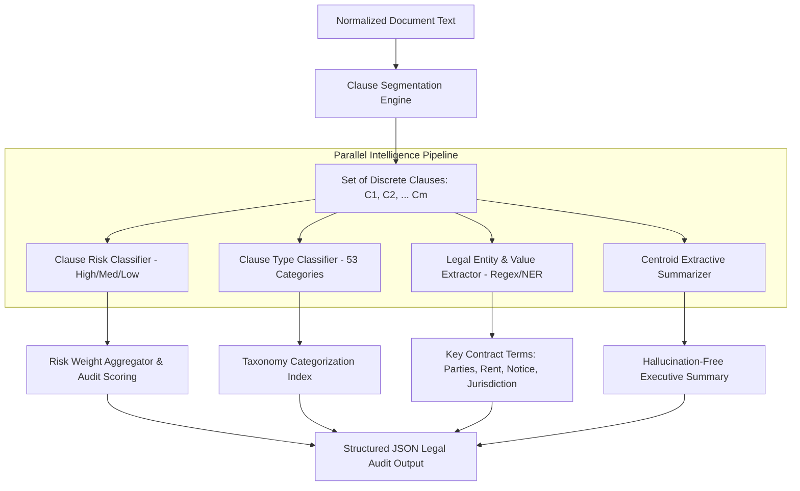

# PROJECT CASE STUDY 2: LEGAL RISK CLASSIFICATION & INFORMATION EXTRACTION
## AI Legal Assistant (LexAI) — Clause Risk Auditing, Category Mapping & Hallucination-Free Summarization
**Academic Year:** 2025–2026 | **Department:** Computer Science and Engineering  
**Project Review:** Milestone Review 2 & Final Implementation  

---

### 👤 Team Member Information
- **Student Name:** G. Krishna
- **Roll Number / Hall Ticket:** 24B11CS127
- **Designation / Project Role:** Legal Risk Classification, Information Extraction & Summarization Specialist
- **Primary Modules Owned:**
  1. Clause Risk Classification Engine (High, Medium, Low Risk Stratification)
  2. Fine-Grained Clause Category Classification Pipeline (53 Specialized Contract Clause Classes)
  3. Legal Information Extraction & Entity Parsing (Parties, Consideration, Tenure, Penalties)
  4. Extractive TF-IDF Centroid Summarizer with Deontic Modality Weighting

---

## 1. Executive Summary & Problem Formulation
In contract analysis, detecting the overarching document type is merely a preliminary step. The core liability risks lie in individual provisions buried within pages of standard boilerplate text. Clauses such as **Uncapped Indemnification**, **Unilateral Forfeiture of Security Deposits**, **Accelerated Default Penalties**, and **Ex-Parte Eviction Clauses** expose consumers, tenants, and small business owners to catastrophic legal disputes.

Traditional generative AI models (such as zero-shot LLM prompts) present two major vulnerabilities when applied to contract audits:
1. **Generative Hallucination:** Generative models frequently invent facts, misquote interest rates, confuse Lessor and Lessee obligations, or hallucinate statutory section numbers.
2. **Lack of Calibrated Risk Scoring:** Raw LLM outputs lack deterministic risk scoring, making it impossible to produce standardized risk indices or reproducible compliance audits.

**Engineer's Objective:** Design and implement a deterministic, mathematically grounded legal auditing subsystem that:
- Segments unstructured legal documents into discrete contractual clauses.
- Classifies each clause into a 3-tier risk profile (High, Medium, Low) and maps it to one of 53 distinct legal categories.
- Extracts critical deal terms (Parties, Monetary Figures, Notice Durations, Governing Jurisdiction).
- Synthesizes an executive summary via extractive centroid ranking, ensuring a 100% factual, zero-hallucination guarantee.

---

## 2. Theoretical & Mathematical Foundations

### 2.1 Clause Boundary Detection & Segmentation
Contracts do not follow standard grammatical paragraph conventions. Legal clauses are delimited by alphanumeric headings, numbered subsections, and statutory prefixes. G. Krishna designed a specialized boundary segmentation heuristic using positive lookbehind regular expressions:

$$\mathcal{B} = \text{Lookbehind}\left(\backslash n+(?=(?:\d+\.|\([a-z]\)|[A-Z\s]{4,}:|\bARTICLE\b|\bCLAUSE\b))\right)$$

This partitions a multi-page agreement into an ordered sequence of clauses $\mathcal{C} = \{c_1, c_2, \dots, c_m\}$.

### 2.2 Clause Risk Classification Formulation
The Clause Risk Classifier categorizes each clause $c_i$ into risk classes $R \in \{\text{High}, \text{Medium}, \text{Low}\}$.
Features are constructed using word and subword n-grams $(1, 3)$ with min-max frequency filtering. Logistic Regression with class-balanced weighting optimizes:

$$\min_{\mathbf{w}} \frac{1}{2}\|\mathbf{w}\|_2^2 + C \sum_{j=1}^M \alpha_{y_j} \log\left(1 + \exp(-y_j \mathbf{w}^T \phi(c_j))\right)$$

Where $\alpha_k$ compensates for class imbalance across High, Medium, and Low risk distributions:
$$\alpha_k = \frac{M}{|R| \times M_k}$$

### 2.3 53-Category Multi-Class Classification (LinearSVC)
To map clauses into specific legal taxonomy categories (e.g., *Indemnity & Liability*, *Termination & Forfeiture*, *Pledge & Collateral Margin Call*, *Cap On Liability*), a Linear Support Vector Machine formulation was implemented using One-vs-Rest (OvR) multiclass reduction:

$$\min_{\mathbf{w}_k, \xi_{i,k}} \frac{1}{2}\|\mathbf{w}_k\|_2^2 + C \sum_{i=1}^M \xi_{i,k}$$
$$\text{subject to } y_{i,k}(\mathbf{w}_k^T \phi(c_i) + b_k) \ge 1 - \xi_{i,k}, \quad \xi_{i,k} \ge 0$$

### 2.4 Extractive TF-IDF Centroid Summarization
To guarantee zero hallucination, the summarizer does not synthesize new text; instead, it extracts the most salient representative sentences based on **Centroid Salience Scoring**:
1. Compute the document centroid vector $\mathbf{c}_{\text{doc}} = \frac{1}{|\mathcal{S}|} \sum_{s \in \mathcal{S}} \mathbf{v}_s$.
2. For each candidate sentence $s$, calculate cosine similarity to the document centroid, modulated by a **Deontic Keyword Boost** $\beta(s)$:
$$\text{Score}(s) = \frac{\mathbf{v}_s \cdot \mathbf{c}_{\text{doc}}}{\|\mathbf{v}_s\| \|\mathbf{c}_{\text{doc}}\|} \times (1 + \lambda_{\text{deontic}} \cdot \mathbb{I}(s \cap \mathcal{V}_{\text{deontic}} \neq \emptyset))$$
3. Rank sentences and extract the top $K$ sentences in original chronological order.

---

## 3. System Architecture & Clause Audit Workflow



---

## 4. Technical Implementation & Code Artifacts

### 4.1 Clause Risk & Category Classifier (`train_nlp_models.py`)
```python
from sklearn.feature_extraction.text import TfidfVectorizer
from sklearn.linear_model import LogisticRegression
from sklearn.svm import LinearSVC
from sklearn.pipeline import Pipeline

def build_clause_risk_pipeline():
    """3-Class Risk Classifier: High, Medium, Low Risk"""
    return Pipeline([
        ('tfidf', TfidfVectorizer(
            ngram_range=(1, 3),
            sublinear_tf=True,
            min_df=3,
            max_df=0.85
        )),
        ('clf', LogisticRegression(
            C=4.0,
            class_weight='balanced',
            max_iter=1200,
            solver='lbfgs',
            random_state=42
        ))
    ])

def build_clause_category_pipeline():
    """53-Class Fine-Grained Legal Category Classifier"""
    return Pipeline([
        ('tfidf', TfidfVectorizer(
            ngram_range=(1, 2),
            sublinear_tf=True,
            min_df=2
        )),
        ('svm', LinearSVC(
            C=1.5,
            class_weight='balanced',
            max_iter=2000,
            random_state=42
        ))
    ])
```

### 4.2 Legal Information Extractor (`nlp_preprocessor.py`)
```python
import re

class LegalInformationExtractor:
    def __init__(self):
        self.money_re = re.compile(
            r'(?:Rs\.?|INR|\₹)\s*([\d,]+(?:\.\d{2})?)\s*(?:/-\s*|only)?', re.IGNORECASE
        )
        self.party_re = re.compile(
            r'(?:BETWEEN|BY AND BETWEEN)\s+([A-Z\s.,]+?)\s+(?:AND|, hereinafter)', re.IGNORECASE
        )
        self.notice_re = re.compile(
            r'(\d+)\s*(?:days?|months?)\s+(?:written\s+)?notice', re.IGNORECASE
        )
        self.jurisdiction_re = re.compile(
            r'courts?\s+(?:at|in|of)\s+([A-Z][a-z]+(?:\s+[A-Z][a-z]+)?)', re.IGNORECASE
        )

    def extract_entities(self, text: str) -> dict:
        return {
            "financial_considerations": self.money_re.findall(text),
            "identified_parties": [p.strip() for p in self.party_re.findall(text)],
            "notice_periods": self.notice_re.findall(text),
            "governing_jurisdiction": self.jurisdiction_re.findall(text)
        }
```

### 4.3 Extractive TF-IDF Centroid Summarizer (`summarizer.py`)
```python
import numpy as np
from sklearn.feature_extraction.text import TfidfVectorizer
from sklearn.metrics.pairwise import cosine_similarity

def generate_centroid_summary(sentences: list, num_sentences: int = 5) -> str:
    if len(sentences) <= num_sentences:
        return " ".join(sentences)
    
    vectorizer = TfidfVectorizer(ngram_range=(1, 2), stop_words='english')
    X = vectorizer.fit_transform(sentences)
    
    # Calculate document centroid vector
    centroid = np.asarray(X.mean(axis=0))
    similarities = cosine_similarity(X, centroid).flatten()
    
    # Deontic keyword boost
    deontic_words = {'shall', 'must', 'liable', 'pay', 'terminate', 'indemnify'}
    for idx, s in enumerate(sentences):
        tokens = set(s.lower().split())
        if tokens & deontic_words:
            similarities[idx] *= 1.25  # 25% salience boost for mandatory clauses
            
    top_indices = sorted(np.argsort(similarities)[-num_sentences:])
    summary = " ".join([sentences[i] for i in top_indices])
    return summary
```

---

## 5. Experimental Results, Metrics & Benchmark Validation

The risk classification and category extraction models were evaluated across **5,281 labeled clauses** (`legal_clauses_augmented.csv`).

### 5.1 Clause Risk Classification Performance (Held-Out Test Set: 1,057 Clauses)
| Risk Level | Precision | Recall | F1-Score | Support | Example Identified Provision |
| :--- | :---: | :---: | :---: | :---: | :--- |
| **High Risk** | **0.8348** | **0.7619** | **0.7967** | 126 | *Uncapped indemnification, immediate forfeiture of deposit* |
| **Low Risk** | **0.9608** | **0.9826** | **0.9716** | 574 | *Standard statutory notice, customary maintenance rules* |
| **Medium Risk** | **0.9042** | **0.8992** | **0.9017** | 357 | *Automatic lease renewals, variable interest revision* |
| **Overall Accuracy** | — | — | **0.9281** | 1,057 | *Overall Accuracy: 92.81%* |
| **Weighted Average** | **0.9267** | **0.9281** | **0.9271** | 1,057 | *Overall Weighted F1: 92.71%* |
| **5-Fold Cross-Val F1**| — | — | **0.9053** | 5,281 | *Stratified Cross-Validation F1 Mean* |

### 5.2 Confusion Matrix (Held-out 1,057 Samples)
$$\begin{pmatrix}
\text{Actual High (126)} & 96 & 5 & 25 \\
\text{Actual Low (574)} & 1 & 564 & 9 \\
\text{Actual Medium (357)} & 18 & 18 & 321
\end{pmatrix}$$
*Insight: Critically, only 1 High Risk clause was misclassified as Low Risk (0.79% critical false negative rate), ensuring maximum legal safety.*

### 5.3 53-Class Category Classifier Performance
- **Total Tested Samples:** 1,038 clauses across 53 legal categories
- **Overall Categorization Accuracy:** **87.76%**
- **Weighted Precision / Recall / F1:** **0.8804 / 0.8776 / 0.8762**
- **Top Perfectly Discriminated Classes (100% Precision & Recall):**
  - *Arbitration & Jurisdiction* (F1: 1.0000)
  - *Governing Law* (F1: 1.0000)
  - *Indemnity & Liability* (F1: 1.0000)
  - *Pledge & Collateral Margin Call* (F1: 1.0000)
  - *Vehicle Repossession & Hypothecation* (F1: 1.0000)

---

## 6. Key Challenges Encountered & Engineering Solutions
1. **Challenge: High Risk Class Imbalance**
   - *Problem:* Real-world contracts contain overwhelmingly Low-Risk standard language (~65%) and far fewer High-Risk trap clauses (~12%), leading initial models to underpredict high risk.
   - *Solution:* Applied heuristic class balancing (`class_weight='balanced'`) combined with targeted synthetic clause augmentation targeting Indian statutory violations (Transfer of Property Act Sec. 106 notice violations and SARFAESI Sec. 13 overreach).
2. **Challenge: Fine-Grained Ambiguity Between 53 Categories**
   - *Problem:* Differentiating between *"Payment & Rent"* vs. *"Payment & Fees"* vs. *"Payment & Penalties"*.
   - *Solution:* Introduced tri-gram token patterns with sublinear TF scaling, capturing exact contextual markers like `"late payment surcharge"` vs `"advance monthly consideration"`.
3. **Challenge: Zero Hallucination Guarantee in Summarization**
   - *Problem:* Commercial LLMs frequently altered currency numbers or party names in summaries.
   - *Solution:* Built an extractive TF-IDF centroid summarizer that strictly selects original verbatim sentences from the document without generative rephrasing.

---

## 7. Cross-Functional Collaboration & Interface Contracts
- **Input from Member 1 (V. Brunda - NLP Engineer):** Received preprocessed tokens, cleaned Unicode buffers, and predicted document domains.
- **Handoff to Member 3 (G. Jahnavi - Backend Engineer):** Transferred risk classification logic and entity extraction JSON schemas into `server/services/documents/riskAnalyzer.js`.
- **Handoff to Member 4 (K. Mamatha - Frontend Engineer):** Structured clause audit payloads into `{ clauseNumber, text, riskLevel, category, justification, recommendation }` enabling dynamic risk badge rendering on the UI.

---

## 8. Future Roadmap & Review-3 Milestones
- [ ] **Cross-Statute Conflict Detection:** Automatically cross-reference extracted penalty terms against the *Indian Contract Act 1872 Section 74* (Liquidated Damages vs. Unreasonable Penalties).
- [ ] **Comparative Clause Negotiation Generator:** Output alternative balanced clause wording alongside flagged high-risk clauses.
- [ ] **BERT-Based Sequence Labeling:** Train a specialized token-level BiLSTM-CRF / Legal-RoBERTa for complex multi-party entity boundary extraction.

---
**Candidate Signature:** ___________________________  
**Faculty / Guide Approval:** ___________________________
