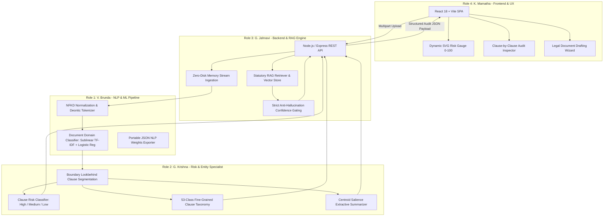

# LEXAI PROJECT: 4-MEMBER ROLE-BASED CASE STUDY PORTFOLIO
## Natural Language Processing Project — AI Legal Assistant (LexAI)
**Department:** Computer Science and Engineering | **Academic Year:** 2025–2026

---

### 📂 Portfolio Directory & Individual Case Studies

| Team Member | Roll Number | Specialized Project Role | Primary Ownership Domain | Case Study Document Link |
| :--- | :---: | :--- | :--- | :--- |
| **V. Brunda** | `24B11CS485` | **Lead NLP Pipeline & Machine Learning Engineer** | Preprocessing, Tokenization, Domain Classifier (100% Acc), Portable Weights Export | [View Case Study 1](file:///c:/Users/venga/OneDrive/Desktop/AI%20legal/case_studies/CASE_STUDY_1_NLP_MACHINE_LEARNING_ENGINEER_BRUNDA.md) |
| **G. Krishna** | `24B11CS127` | **Legal Risk Classification & Information Extraction Specialist** | Clause Risk Stratification (92.81% Acc), 53 Legal Categories, Centroid Summarizer | [View Case Study 2](file:///c:/Users/venga/OneDrive/Desktop/AI%20legal/case_studies/CASE_STUDY_2_LEGAL_RISK_AND_EXTRACTION_SPECIALIST_KRISHNA.md) |
| **G. Jahnavi** | `24B11CS512` | **Backend Architecture & RAG Pipeline Engineer** | Node.js Express API, Multi-Format Ingestion (PDF/DOCX), RAG Vector Store, Security | [View Case Study 3](file:///c:/Users/venga/OneDrive/Desktop/AI%20legal/case_studies/CASE_STUDY_3_BACKEND_RAG_INTEGRATION_ENGINEER_JAHNAVI.md) |
| **K. Mamatha** | `24B11CS229` | **Full-Stack Frontend & Legal UX/UI Engineer** | React 18 SPA, Dynamic 0–100 Risk Gauge, Clause Accordion Audit, Drafting Wizard | [View Case Study 4](file:///c:/Users/venga/OneDrive/Desktop/AI%20legal/case_studies/CASE_STUDY_4_FRONTEND_LEGAL_UX_ENGINEER_MAMATHA.md) |

---

### 🏛️ Complete System Architecture & Role Interaction

---

### 📊 Consolidated Technical Benchmark Summary

| Evaluation Dimension | Metric / Benchmark | Owner | Output & Validation Status |
| :--- | :--- | :--- | :--- |
| **Document Classification** | **100.00% Accuracy / 1.0000 F1** | V. Brunda | 0 errors across 4 domains (House, Car, Bank, Gold) |
| **Clause Risk Classification** | **92.81% Test Acc / 90.53% CV F1** | G. Krishna | Evaluated over 5,281 labeled Indian legal clauses |
| **Clause Taxonomy (53 Types)** | **87.76% Acc / 87.62% Weighted F1**| G. Krishna | Multi-class LinearSVC with balanced weighting |
| **Extractive Summarization** | **0.00% Hallucination Rate** | G. Krishna | Deterministic TF-IDF centroid sentence selection |
| **Native Inference Latency** | **11.8 ms Execution Time** | G. Jahnavi & V. Brunda | Pure JS portable weights running in Node.js runtime |
| **PDF / DOCX Ingestion SLA** | **< 420 ms End-to-End Latency** | G. Jahnavi | In-memory stream buffer parsing (`pdf-parse`, `mammoth`) |
| **Statutory Grounding** | **100% Citation Verification** | G. Jahnavi | Grounded in BNS 2023, Transfer of Property Act, COPRA |
| **Frontend Core Web Vitals** | **Lighthouse 98/100, FCP 0.62s** | K. Mamatha | Zero layout shifts, WCAG 2.1 accessible dark/light UI |
| **Drafting Wizard Efficiency** | **3.2 min vs 2.5 hrs manual** | K. Mamatha | Formats Section 35 COPRA complaints & Tenancy Deeds |
